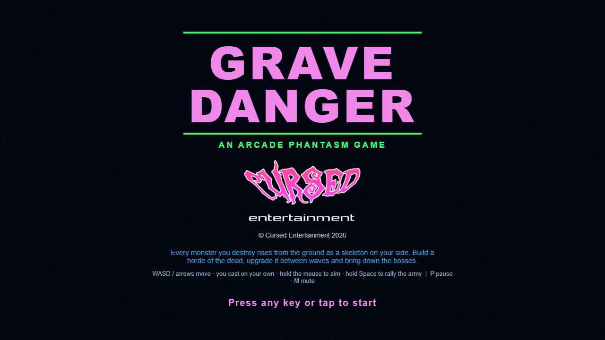
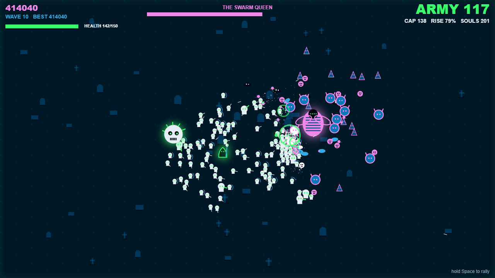
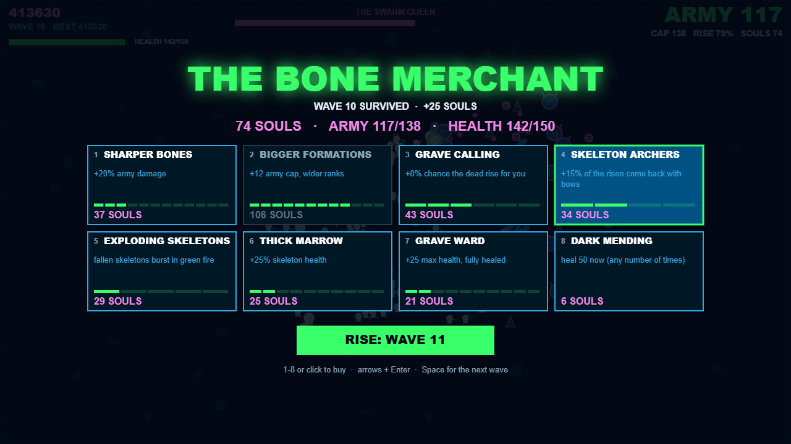

 

  

 

  
  
  

 

# GRAVE DANGER

**An [Arcade Phantasm](https://arcade-phantasm.netlify.app/) game**

### [Play it](https://cursedprograms.github.io/GraveDanger/)

A survival arcade game where every monster you destroy rises again as a skeleton on your side. You're a necromancer in a graveyard; your followers swarm the nearest threat on their own. Upgrade your army between waves and face enormous bosses.

**The twist:** Your army grows as the difficulty does: the harder it gets, the bigger your horde of the dead.

  
  
  

## How to play

- **Raise the dead.** When a monster dies it may climb back out of the ground as your skeleton (the RISE chance), as long as your army is under its cap. Brutes rise as hulking skeletons; cultists come back with bows.
- **Let them fight.** Your skeletons swarm the nearest threat near you, then fall back into rings around you. You cast soul bolts at the nearest monster on your own; hold the mouse to aim them yourself. Hold Space to rally the whole army back to you.
- **Spend souls.** Every kill gives souls. Between waves the Bone Merchant sells upgrades: Sharper Bones (damage), Bigger Formations (army cap and wider ranks), Grave Calling (rise chance), Skeleton Archers, Exploding Skeletons, Thick Marrow (skeleton health), Grave Ward (your health) and Dark Mending (heal).
- **Topple the bosses.** Every fifth wave a boss comes: the Bone Colossus (ground slams), the Swarm Queen (a brood of imps) and the Cursed Knight (charges through your ranks). Bring one down and it rises as a giant skeleton on your side.
- The monsters get tougher and more numerous every wave. If your health runs out, you join the dead.

## Controls

| | Keyboard + mouse | Phone / tablet |
| --- | --- | --- |
| Move | WASD or arrow keys | Thumb stick (left side of the screen) |
| Cast | Automatic; hold the left mouse button to aim | Automatic |
| Rally the army | Hold Space (or Shift, or the right mouse button) | Hold RALLY |
| Shop | 1-8 or click to buy, arrows + Enter, Space for the next wave | Tap a card, tap RISE |
| Pause / mute | P / M | II / ♪ at the bottom |

The best score is saved in the browser.

## Versions

- **Browser** (this repo's root): [play it](https://cursedprograms.github.io/GraveDanger/)
- **Windows exe**: coming, in `cpp/`
- **Android**: coming, in `android/`

## Files

- `index.html`: the page (the canvas and the title screen)
- `site/style.css`: the page's styling
- `site/game.js`: the game: units, the spatial hash that keeps hundreds of them at 60 fps, waves, bosses, the shop, drawing, controls
- `site/sfx.js`: every sound, made with the Web Audio API (no audio files)
- `images/`: the Cursed logo and the screenshots

Plain HTML5 canvas and JavaScript, no frameworks and no build step. Open `index.html#shot` for the frozen boss battle and `index.html#shop` for the shop, as used for the screenshots.

## Also in the arcade

[KillerStardust](https://github.com/CursedPrograms/KillerStardust) · ProtocolHex · Seance · [RicochetReaper](https://github.com/CursedPrograms/RicochetReaper) · [GraveDanger](https://github.com/CursedPrograms/GraveDanger) · Vortex · Orbit · RocksOfRuin · Devourer

 

© Cursed Entertainment 2026

 

